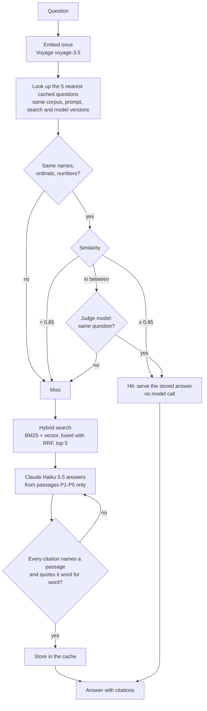

# Delphi RAG

[](https://github.com/zeusydev-lang/delphi-rag/actions/workflows/ci.yml)

**Ask questions about Plutarch's *Lives* and get answers that cite the exact
passages they came from. Every citation is checked against the text, and a
semantic cache answers repeat questions for free, without ever giving one
question another question's answer.**

**Try it: https://delphi-rag.delphi-rag.workers.dev** (3 questions a minute
for the whole site, and a small daily budget, after which it answers only from
the cache).

## The problem

Plutarch is full of people who are easy to mix up. Tiberius and Caius Gracchus
were brothers who both led reforms and both died violently. Cato the Elder and
Cato the Younger were both named Marcus Porcius Cato. To a vector search,
"How did Tiberius Gracchus die?" and "How did Caius Gracchus die?" are almost
the same question: on this corpus their passages scored **0.0002 apart**.

That makes two common RAG shortcuts dangerous:

- **Retrieval** can return the right story about the wrong person, and a model
  will happily answer from it.
- **A semantic cache**, which reuses an answer when a new question is similar
  enough to an old one, will serve Tiberius's death for a question about Caius.
  Fast and confidently wrong is worse than slow.

This project builds the whole path (load the text, search it, answer with
citations, cache answers) and measures each step on questions designed to
catch exactly these mix-ups.

## How it works



1. **Load:** [Project Gutenberg #674](https://www.gutenberg.org/ebooks/674) is
   split at each Life's heading into paragraph sections (the text has no chapter
   numbers), giving 470 chunks for seven Lives. Each chunk is embedded with
   `Plutarch, Life of <name>, section <n>.` in front, because most paragraphs
   say "he", not the person's name.
2. **Search:** Neon Postgres holds a pgvector index and a BM25 index
   (`lakebase_text`), and the two rankings are combined with Reciprocal Rank
   Fusion.
3. **Answer:** Claude Haiku 5.5 gets the top 5 passages in tags and must cite a
   passage id and an exact quote for every claim. Code checks each quote against
   its passage and sends a bad answer back once. If the passages don't answer
   the question, the model has to say so instead of answering from memory.
4. **Cache:** a names/ordinals/numbers check runs first and is free, then the
   similarity thresholds, then a small judge model for the gray zone.
5. **Website:** a static page on Cloudflare sends questions to a Cloudflare
   Worker, which checks the origin, the length, Cloudflare Turnstile and the
   rate limits, then calls the Python API on Google Cloud Run with a shared
   secret. The API runs the same code the evals test, and past a $0.10 daily
   budget it answers only from the cache.

## Results

<!-- results:start -->
<!-- Generated by `uv run python -m scripts.eval_report --write-readme`. Don't edit by hand. -->

**Retrieval**: 33 hand-labelled questions (search `rrf-v1`, labels v2, 2026-11-15)

| | hit@5 | hit@1 | MRR | near-miss: right Life first |
|---|---|---|---|---|
| BM25 alone | 0.73 | 0.61 | 0.67 | 0.92 |
| **Vector alone** | 0.97 | 0.76 | 0.83 | 0.92 |
| Hybrid (RRF) | 0.91 | 0.70 | 0.79 | 0.92 |

**Answers**: claude-haiku-5-5, prompt `a1`, over `rrf-v1` (2026-11-15)

| | |
|---|---|
| answered (33 answerable questions) | 0.94 |
| cites an expected passage | 0.91 |
| main citation from the right Life | 0.97 (near-miss 1.00) |
| declined (5 unanswerable questions) | 1.00 |
| cost for 38 questions | $0.0219 |

**Semantic cache**: gate `c2` (hit at >= 0.95, miss below 0.85, judge `j2`)

| | main pairs | held-out pairs |
|---|---|---|
| pairs | 38 | 10 |
| **false hits** (a wrong answer served) | **0** | **0** |
| true paraphrases served from the cache | 0.86 | 1.00 |
| judge calls | 11 | 7 |
<!-- results:end -->

What the numbers say:

- **Vector search beat hybrid search on this corpus.** BM25 latches onto a word
  in the wrong passages: "How did Cato die at Utica?" ranks the many sections
  that *mention* Utica above the death scene, which never uses the word. Plain
  fusion lets those push correct passages down, and halving BM25's weight
  didn't fix it. Answers still use hybrid search (see Key decisions).
- **The near-miss problem was mostly solved at load time.** Putting the Life's
  name in front of every embedded chunk is likely why vector search picks the
  right Gracchus or Cato almost every time.
- **When search misses, the model says so.** Both answerable misses ("How did
  Cato die at Utica?", "What did Pompey do when his army broke?") came back as
  "the passages don't describe this", not as an answer from memory.
- **The cache never served a wrong answer.** The free signature check stopped
  all 20 near-miss pairs, including Cato the Elder vs the Younger at 0.969
  similarity, which thresholds alone would have served.
- **Not measured yet:** whether an answer is *correct* beyond its citations.
  That needs a judge model, and that judge needs testing of its own.

Each eval's method, failures and cost are in the
**[operations guide](docs/OPERATIONS.md)**.

## Key decisions

- **`lakebase_text` for BM25, not `pg_search`.** Neon deprecated `pg_search` in
  2026. A spike showed `lakebase_text` works from a read-only login, before any
  search code was written.
- **The person's name goes into what gets searched, not just the metadata.**
  Embeddings start with `Plutarch, Life of <name>`, and the BM25 column indexes
  the name with the text. Neither changes the stored text, which stays exactly
  Plutarch's words for citations.
- **Hybrid search for answers, even though vector search won the eval.** This
  was the owner's call: exact keyword matching on rare names may matter more on
  the full 52 Lives. Every answer records its `search_version`, so the choice
  can be measured again.
- **Citations are checked in code.** Claude's built-in citations feature can't
  be combined with structured output, and checking in code keeps the project
  provider-neutral (through litellm). A quote that isn't word for word in the
  passage it names is refused.
- **The cheap check before the clever one.** Names, ordinals and numbers are
  compared before any similarity threshold or model call. It's strict on
  purpose: a missed cache hit costs half a cent, and a wrong cached answer costs
  trust.
- **Thresholds set before measuring.** 0.95 and 0.85 came from the spec and
  were not tuned to the eval. Weighted RRF's 0.5 was chosen before its single
  run.
- **Held-out data before any fix.** When the cache judge failed once, new test
  pairs were written and committed before the fix, so the fix couldn't be
  fitted to them.
- **One database login per job.** `ingest` can add chunks but not change them,
  `query` can read and add cache entries but not change or delete answers, and
  `eval` can only record eval runs. The owner login is used only for
  migrations.
- **Tests never call a paid API.** Fake Claude and Voyage servers run on
  localhost. Database tests run against a Neon test branch locally, and against
  a throwaway Postgres with pgvector in CI.

## What went wrong, and what changed

- **BM25 returned passages that don't match at all.** On a small table,
  Postgres read every row and returned non-matches with a score of 0, which
  would have earned them a place in fusion. `EXPLAIN` showed it depends on the
  plan, so search now always drops zero scores.
- **The free embedding tier ran out mid-load.** Voyage's free tier allows 3
  requests a minute, and litellm's own quick retries used all 3 at once. The
  loader now paces its calls, waits out rate limits itself, and resumes where it
  stopped. The first load stopped at 160 of 470 chunks and lost nothing.
- **Hybrid search lost to vector search.** That's recorded, not explained
  away, and one fix was tried and measured once. It didn't help, so it wasn't
  kept.
- **A metric was wrong, and so were two labels.** "Right Life" first failed
  answers that rightly added a citation from another Life (Pompey's account of
  the Rubicon, say). It now checks the main citation. Two eval questions turned
  out to have a second correct passage. Both corrections are marked in the eval
  files, and the evals were rerun.
- **The cache judge let one wrong answer through.** It decided "How many
  talents did the pirates *ask*?" and "...did Caesar *promise to pay*?" were the
  same question (Plutarch has 20 asked, 50 promised). A stricter prompt fixed
  it, checked on pairs written beforehand.
- **A pull request was merged a minute before its last commit.** That commit
  went in through a follow-up PR. Small, but it's why each PR now gets its final
  results before review.

## What I'd do next

- **An answer-correctness judge**, and tests for that judge, so "correct" is
  measured and not only "well cited".
- **Fix BM25's word matching** (for example, don't let a place name outweigh
  the event), then measure hybrid against vector again.
- **The full ~52 Lives**, now that the evals work. Rare names should show
  whether BM25 earns its place.
- **More held-out cache pairs** for every future change to the gate.

## Tech stack

Python 3.13 · Pydantic · litellm · Claude Haiku 5.5 (answers and cache judge) ·
Voyage embeddings · Neon Postgres with pgvector and lakebase_text (BM25) ·
psycopg · FastAPI on Google Cloud Run · Cloudflare Workers and Turnstile ·
pytest · vitest · Ruff · GitHub Actions

## Repository layout

```text
api/          the HTTP API behind the website (FastAPI, Cloud Run)
worker/       the Cloudflare Worker in front of it (TypeScript)
web/          the website (static HTML, CSS and JavaScript)
agent/        model calls: chat, embeddings, structured output, answers, cache judge
core/         settings, database logins, corpus chunking, search, cache, signatures, eval records
scripts/      fetch and load the corpus, ask, the three evals, the eval report
evals/        eval questions and pairs; saved results per version
migrations/   SQL schema, database logins and permissions
tests/        unit tests with fake model servers; database tests
docs/         operations guide
```

## Running it

Setup, Neon branches, logins, loading the corpus, asking questions and running
the evals are all in the **[operations guide](docs/OPERATIONS.md)**.

## Credits

Built by Vijay Kauvangal. Built with Claude Code as a pair-programming partner.

The text is Plutarch's *Lives* in the translation associated with John Dryden,
revised by Arthur Hugh Clough: [Project Gutenberg eBook #674](https://www.gutenberg.org/ebooks/674),
public domain in the USA. The first corpus covers seven Lives: both Catos, both
Gracchi, Caesar, Pompey and Crassus.
